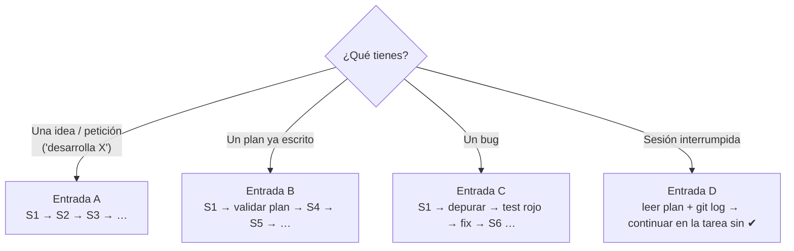

# Línea de desarrollo con IA — del punto 0 al navegador

Runbook único: desde "tengo una idea / un plan / un bug" hasta "está probado en código **y** en el navegador, documentado y listo para mergear".
Cada etapa tiene: **qué skill usar**, **qué se produce** y un **gate** (criterio de salida). No se pasa a la siguiente sin cumplir el gate.

Documentos hermanos: estrategia de pruebas y recorridos de navegador → [`TESTING.md`](TESTING.md) · catálogo de skills → [`SKILLS.md`](SKILLS.md) · resumen corto → [`WORKFLOW.md`](WORKFLOW.md).

**Leyenda de estado de skills:** ✅ instalada en el repo (`.agents/skills/`) · 🌐 solo en plugin global del usuario (funciona aquí, **no viaja con el repo**) · ❌ no instalada → ver [§ Qué instalar](#qué-instalar).

---

## 0. Elige tu punto de entrada



| Entrada | Cuándo | Ruta |
|---|---|---|
| **A. Idea / petición** | "Quiero un módulo de…", "agrega el indicador…" | S0 → S1 → S2 → S3 → S4 → S5 → S6 → S7 → S8 → S9 |
| **B. Plan existente** | Ya hay `docs/superpowers/plans/*.md` aprobado | S1 → *revalidar el plan contra el código actual* → S4 → S5 → … |
| **C. Bug** | Algo se calcula/ve mal | S1 → `systematic-debugging` ✅ → **test que falla** → fix → S6 → (S7 si hay UI) → S9 |
| **D. Retomar** | Se perdió contexto | Leer plan (✔ solo con evidencia) + `git log -n 10` + `git status` → seguir |
| **Trivial** (typo, copy, estilo) | Sin lógica ni datos | S1 → S5 → S6 (typecheck+lint) → S7 (mirar la pantalla) → commit |

Una tarea **sin cálculo y sin BD** puede saltarse S2–S3 si cabe en un commit pequeño. Una tarea con **fórmula o tabla nueva nunca** se salta S2.

---

## S0 · Preparar entorno *(una vez por máquina, y al empezar cada sesión larga)*

| Acción | Detalle |
|---|---|
| Versiones | Node ≥ 22, pnpm ≥ 10 |
| Dependencias | `pnpm install` |
| Variables | Copiar `.env.example` → `.env.local`. **Apuntar a un proyecto Supabase de pruebas, nunca al de producción** |
| Esquema | Migraciones de `supabase/migrations/` aplicadas en ese proyecto |
| Usuarios de prueba | Dos cuentas (A y B) para verificar RLS. Ver `TESTING.md` §Datos |
| Línea base | Correr la escalera de verificación (S6) **antes de cambiar nada** y anotar el resultado |
| Herramientas de prueba | Ver [§ Qué instalar](#qué-instalar) |

**Gate S0:** la línea base está anotada. Si ya estaba roja, queda registrado qué falla *antes* de tu cambio; no es tuyo, pero tampoco lo escondes.

> **Estado de este repo hoy:** no hay runner de tests, `eslint` no está instalado y `next.config.mjs` tiene `typescript.ignoreBuildErrors: true`
> (⇒ `pnpm build` **no** comprueba tipos). Hasta resolverlo (Audit P0 #1–#2), la línea base real solo se obtiene con `pnpm exec tsc --noEmit`.

---

## S1 · Orientar *(siempre, minutos)*

| Skill / herramienta | Estado | Uso |
|---|---|---|
| `AGENTS.md` | repo | Reglas no negociables y mapa de lectura |
| `using-superpowers` | ✅ | Antes de actuar: ¿aplica alguna skill? |
| `codebase-memory-mcp` (`search_graph`, `trace_path`) | MCP de usuario | Encontrar engine/servicio existente y sus llamadores |
| `graphify` | ✅ (grafo aún sin generar) | Solo para mapas de arquitectura globales |

Acciones: leer `AGENTS.md` + el documento de dominio que aplique → `search_graph` por lo que vas a tocar → `git status` y `git log -n 10`.

**Artefacto:** nota de 3 líneas: *qué archivos tocaré · qué regla de dominio aplica · qué ya existe y reutilizaré*.
**Gate S1:** no hay contradicción abierta entre docs y código (si la hay, **manda el código** y la discrepancia se anota).

---

## S2 · Especificar *(Entrada A)*

| Situación | Skill | Estado |
|---|---|---|
| Idea abierta | `brainstorming` | ✅ |
| Ya hay idea y quieres que la cuestionen (sobre todo reglas financieras) | `grill-me` | ✅ |
| Requisito ya claro y pequeño | — | — |

**Artefacto:** `docs/superpowers/specs/AAAA-MM-DD-<tema>-design.md` (ruta por defecto de `brainstorming`; contenido mínimo en [`templates/feature-spec.md`](../templates/feature-spec.md)).

La spec **debe** traer, además de lo habitual:

1. **Ejemplo numérico resuelto a mano** (si hay cálculo) — será el test de oro de S5.
2. **Recorrido de navegador esperado** en formato *Dado / Cuando / Entonces* con valores visibles — será la prueba de S7.
3. Estados de UI: vacío, cargando, error, con datos; ES y EN.
4. Qué **no** entra.

**Gate S2:** el humano aprobó la spec. Una duda de ingeniería económica se **pregunta**, no se supone.

---

## S3 · Planear *(Entrada A, tras S2)*

| Skill | Estado |
|---|---|
| `writing-plans` | ✅ |

**Artefacto:** `docs/superpowers/plans/AAAA-MM-DD-<tema>.md`.

Reglas del plan para este repo (además de las de la skill):

- Orden **de adentro hacia afuera**: `engine + test` → `migración + RLS` → `service` → `server action` → `página/componente` → `i18n` → `docs` → **tarea final de verificación en navegador**.
- Cada tarea: archivos exactos · test que falla primero · comando de verificación con la salida esperada · commit convencional.
- La **última tarea** siempre es "Ejecutar recorridos J… de `TESTING.md` y adjuntar evidencia".
- Los `- [ ]` se marcan **solo** con evidencia pegada (salida del comando o captura).

**Gate S3:** el humano aprobó el plan; ninguna tarea es "implementar el módulo X" (son pasos de minutos, no de horas).

---

## S4 · Aislar

| Skill | Estado |
|---|---|
| `using-git-worktrees` | 🌐 |

Rama `feat/<tema>` (o worktree si el trabajo es largo o paralelo). Commits convencionales (`feat:`, `fix:`, `test:`, `docs:`…), uno por tarea del plan.
Si la skill no está disponible: `git switch -c feat/<tema>` es suficiente.

**Gate S4:** árbol de trabajo limpio al empezar; la rama no mezcla temas.

---

## S5 · Construir *(bucle por tarea)*

### Cómo ejecutar el plan

| Modo | Skill | Cuándo |
|---|---|---|
| Subagente por tarea + revisión entre tareas | `subagent-driven-development` ✅ | Tareas independientes (recomendado) |
| En la misma sesión | `executing-plans` ✅ | Plan corto o con dependencias fuertes |
| Varios frentes sin estado compartido | `dispatching-parallel-agents` 🌐 | Módulos no relacionados |

### Mini-ciclo de cada tarea

```
1. Test que falla  →  correrlo y VER el fallo        (test-driven-development 🌐)
2. Código mínimo   →  test en verde                  (ponytail ✅: el diff más pequeño que lo cumpla)
3. Refactor        →  test sigue en verde
4. Typecheck + lint de lo tocado
5. Commit convencional
```

### Skill de dominio según la capa

| Capa | Skill | Estado |
|---|---|---|
| Fórmula / engine | `test-driven-development` | 🌐 → **instalar** |
| Migración, RLS, índices | `supabase-postgres-best-practices` | ✅ |
| Sesión / auth | `nextjs-supabase-auth` | ✅ |
| Rutas, RSC, server actions | `nextjs-app-router-patterns`, `nextjs-best-practices` | ✅ |
| Componentes | `shadcn` | ✅ |
| Pantallas del dashboard | `design-taste-frontend` (modo *app screens*), `ui-ux-pro-max` | ✅ |
| Responsive | `tailwindcss-mobile-first` | ✅ |
| Algo falla | `systematic-debugging` | ✅ |

Reglas que no se rompen en esta etapa: unidades (`%` vs decimal), periodos (`t=0` inversión), nada de matemática fuera de `lib/engines/`, RLS en toda tabla nueva, textos en `es.json` y `en.json`, sin `any`, sin `console.log`.

**Gate S5:** todas las tareas del plan con su commit; ningún test en rojo; sin cambios fuera del alcance.

---

## S6 · Verificar en código *(escalera L0 → L3, falla rápido)*

| Skill | Estado |
|---|---|
| `verification-before-completion` | 🌐 → **instalar** |

Ejecuta **en orden** y no continúes si un peldaño falla:

| Nivel | Qué prueba | Comando (objetivo) |
|---|---|---|
| **L0** Estático | Tipos y estilo | `pnpm typecheck` · `pnpm lint` |
| **L1** Unitario | Engines puros con valores calculados a mano | `pnpm test` |
| **L2** Datos / RLS | Migración válida y aislamiento entre usuarios | `supabase db push --dry-run` · prueba con usuarios A y B |
| **L3** Integración | Service + engine contra BD de pruebas; coherencia UI↔engine | `pnpm test` (suite de integración) |
| Build | Compila y arranca | `pnpm build` |

Detalle de cada nivel, valores de oro y casos borde: [`TESTING.md`](TESTING.md).

**Gate S6:** salida **fresca y completa** de cada comando pegada en el reporte. "Debería funcionar" no cuenta.

---

## S7 · Verificar en navegador *(L4 → L5)*

| Herramienta | Estado | Uso |
|---|---|---|
| `agent-browser` | skill ✅ · **CLI ❌ no instalado** | Recorridos guiados y exploración (`agent-browser skills get core` / `dogfood`) |
| Playwright (`@playwright/test`) | ❌ | Recorridos repetibles en CI (J1–J3 mínimo) |
| `chrome-devtools` · `a11y-debugging` · `debug-optimize-lcp` | 🌐 (plugin) | Consola, red, accesibilidad, rendimiento |
| `accessibility` | ✅ | Criterios WCAG 2.2 |

Procedimiento:

1. Levantar la app (`pnpm dev`) con `.env.local` de **pruebas**.
2. Ejecutar los recorridos que pide la spec **más J1 (sesión) como humo de regresión**. Catálogo en `TESTING.md` §Recorridos.
3. En cada paso comparar el **valor visible** con el calculado a mano (no basta "no explotó").
4. Revisar en **ES y EN**, con estado vacío y con datos.
5. Registrar: errores de consola = 0, peticiones fallidas (4xx/5xx inesperadas) = 0.
6. Accesibilidad (foco con teclado, etiquetas, contraste) y rendimiento (LCP) en las páginas nuevas.
7. Guardar capturas en `evidence/` (ignorado por git) y referenciarlas en el reporte/PR.

**Si algo falla:** `systematic-debugging` → escribir el test de regresión en el **nivel más bajo** que lo detecte (idealmente L1) → arreglar → **volver a S6**, no solo repetir el navegador.

**Gate S7:** cada criterio *Dado/Cuando/Entonces* de la spec tiene ✔ con evidencia; sin errores de consola.

---

## S8 · Revisar

| Skill | Estado | Foco |
|---|---|---|
| `ponytail-review` | ✅ | ¿Sobra código? ¿Es seguro? ¿Está probado lo riesgoso? |
| `code-review` | ✅ | Estándares del repo + cumplimiento de la spec, en paralelo |
| `requesting-code-review` / `receiving-code-review` | ✅ | Pedir y procesar feedback con rigor técnico |

Lista de revisión financiera (añádela siempre): unidades · convención de periodos · signos de flujos · filtro `flow_type` · ¿se reutilizó el engine? · ¿TMAR vs tasa de descuento?

**Gate S8:** hallazgos críticos/altos resueltos o aceptados por escrito.

---

## S9 · Documentar y cerrar

| Si cambió… | Actualiza |
|---|---|
| Fórmula, regla, convención | `docs/domain/BUSINESS-LOGIC.md` |
| Tablas, capas, seguridad | `docs/architecture/ARCHITECTURE.md` |
| Un recorrido o ruta nueva | `docs/ai/TESTING.md` (catálogo de recorridos) |
| Decisión con trade-offs | ADR en `docs/adr/` |
| Setup / comandos | `README.md` |
| Atajo consciente | comentario `// shortcut: <motivo>` |

Cierre: reporte de evidencia (formato abajo) → `finishing-a-development-branch` 🌐 (o PR manual) → mensaje de commit/PR convencional.

**Gate S9 = Definición de Hecho** (`AGENTS.md` §6) completa.

---

## Reporte de evidencia (pegar al cerrar)

```markdown
## Evidencia
| Nivel | Comando / recorrido | Resultado |
|---|---|---|
| L0 | `pnpm typecheck` / `pnpm lint` | exit 0 / 0 warnings |
| L1 | `pnpm test` | 24 passed |
| L2 | `supabase db push --dry-run` + usuarios A/B | OK; B no ve datos de A |
| Build | `pnpm build` | OK |
| L4 | J2 proyecto dorado (ES y EN) | VPN 243 ✔ · TIR 23,38 % ✔ · captura `evidence/…` |
| L5 | consola / a11y / LCP | 0 errores · sin hallazgos · LCP 1,8 s |

**No verificado:** <lo que no se probó y por qué>
**Riesgos / atajos:** <…>
```

Regla: lo que no está en la tabla **no se afirma**. Todo lo que quedó fuera va a "No verificado".

---

## Prompts de arranque (copiar y pegar)

**A · Desde cero**
> Lee `AGENTS.md` y `docs/ai/DEVELOPMENT-LIFECYCLE.md`. Quiero: **[qué]**. Sigue la Entrada A: orienta (S1), haz brainstorming y guarda la spec en `docs/superpowers/specs/` con ejemplo numérico y recorrido de navegador (S2). **Detente y espera mi aprobación** antes de planear.

**B · Ejecutar plan**
> Lee `AGENTS.md` y `docs/ai/DEVELOPMENT-LIFECYCLE.md`. Ejecuta el plan `docs/superpowers/plans/<archivo>.md` (Entrada B). Revalida primero que sigue siendo coherente con el código actual. Usa subagent-driven-development y TDD. No marques tareas sin evidencia.

**C · Bug**
> Lee `AGENTS.md`. Bug: **[síntoma · pasos · esperado vs obtenido]**. Entrada C: systematic-debugging, escribe primero un test que falle en el nivel más bajo posible, arregla y corre la escalera S6. Si hay UI, repite el recorrido en el navegador.

**Probar lo ya hecho**
> Lee `docs/ai/TESTING.md`. Ejecuta la escalera L0–L3 y luego los recorridos **[J…]** en el navegador con agent-browser, en ES y EN. Entrega el reporte de evidencia; lo que no pudiste probar va en "No verificado".

**Revisar rama**
> Corre `ponytail-review` y `code-review` sobre `git diff main...HEAD` y añade la lista de revisión financiera.

---

## Qué instalar

Prioridad **P0** = sin esto el ciclo no puede cumplir sus gates.

### Skills (se instalan en `.agents/skills/` y quedan versionadas en `skills-lock.json`)

La skill CLI que generó `skills-lock.json` es `npx skills`. Para traer las de `obra/superpowers`:

```bash
npx skills add obra/superpowers      # selecciona las que se listan abajo
```

| Prioridad | Skill | Por qué |
|---|---|---|
| **P0** | `test-driven-development` | Hoy solo existe en el plugin global; sin ella S5/S6 pierden su disciplina en otros agentes o equipos |
| **P0** | `verification-before-completion` | Es la puerta de S6/S9: "evidencia antes de afirmar" |
| P1 | `using-git-worktrees` | Aislamiento en S4 |
| P1 | `finishing-a-development-branch` | Cierre ordenado en S9 |
| P2 | `dispatching-parallel-agents` | Paralelismo en S5 |
| P2 | Una skill de Playwright (buscar con `find-skills` / `npx skills find playwright`) | Escribir recorridos E2E repetibles |
| Opcional | Skills de accesibilidad/rendimiento del plugin `chrome-devtools` | Ya existen en global; instalar local solo si necesitas que viajen con el repo |

> Si instalas las 5 de `superpowers` en local, **no desactives** el plugin global: solo habría duplicidad inocua. Lo que sí debes evitar es quitar el plugin sin haberlas instalado antes.

### Herramientas (no son skills; hacen falta para los gates)

| Prioridad | Herramienta | Para qué | Instalación |
|---|---|---|---|
| **P0** | `vitest` | L1/L3 | `pnpm add -D vitest` + script `"test": "vitest run"` |
| **P0** | Script `typecheck` | L0. Hoy `pnpm build` no tipa (`ignoreBuildErrors: true`) | `"typecheck": "tsc --noEmit"`; corregir errores y quitar el flag |
| **P0** | `eslint` + `eslint-config-next` | L0 (`pnpm lint` hoy no funciona) | `pnpm add -D eslint eslint-config-next` |
| **P0** | `agent-browser` (CLI) | S7. La skill está, el binario no | `npm i -g agent-browser && agent-browser install` |
| P1 | Supabase CLI + Docker | L2 local (`supabase start`, `supabase test db` con pgTAP para RLS) | ver docs de Supabase |
| P1 | `@playwright/test` | L4 repetible en CI | `pnpm add -D @playwright/test` |
| P2 | `@testing-library/react` + `jsdom` | Probar hooks como `useProjectForm` | `pnpm add -D …` |
| P2 | GitHub Actions | `typecheck → lint → test → build` en cada PR | `.github/workflows/ci.yml` |

### Orden sugerido de instalación

1. `vitest` + `typecheck` + `eslint` → habilita L0 y L1.
2. `agent-browser` → habilita S7.
3. Skills `test-driven-development` y `verification-before-completion` locales.
4. Supabase local + pruebas de RLS.
5. Playwright + CI.

---

## Modo degradado (si el agente no tiene alguna skill)

Este documento es autosuficiente: los gates y los pasos están escritos aquí. Si falta una skill:

| Falta | Haz esto |
|---|---|
| `test-driven-development` | Escribe el test, córrelo, **mira que falle**, y solo entonces implementa |
| `verification-before-completion` | No afirmes nada sin pegar la salida de los comandos de S6 |
| `agent-browser` | Recorre `TESTING.md` §Recorridos a mano y adjunta capturas |
| `using-git-worktrees` | `git switch -c feat/<tema>` |
| `writing-plans` / `brainstorming` | Usa `templates/feature-spec.md` y una lista de tareas con test + comando + commit |

---

## Anti-patrones

- "Compila" tomado como "funciona" (con `ignoreBuildErrors` ni siquiera tipa).
- Probar solo el camino feliz en el navegador y en un solo idioma.
- Comparar la UI contra la propia UI en vez de contra un valor calculado a mano.
- Arreglar un bug visto en el navegador sin test de regresión.
- Probar contra el proyecto Supabase de producción.
- Plan donde todo está `[x]` y ninguna casilla tiene evidencia.
