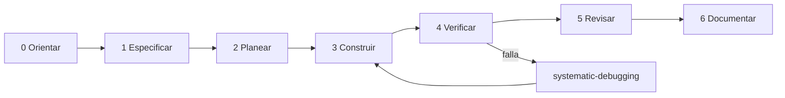

# Metodología de desarrollo con IA — EconoLab

> **Este archivo es el resumen.** El runbook completo, etapa por etapa, con puntos de entrada (idea / plan / bug), gates, pruebas en código y en navegador,
> prompts de arranque y qué instalar está en [`DEVELOPMENT-LIFECYCLE.md`](DEVELOPMENT-LIFECYCLE.md). La estrategia de pruebas está en [`TESTING.md`](TESTING.md).
> Si algo aquí contradice al runbook, **gana el runbook**.

Objetivo: que cualquier persona (o agente) pueda abrir el repo, pedir "agrega X" y obtener un resultado
consistente, verificable y documentado, **sin tener que explicar el proyecto desde cero**.

Principio rector: **separar proceso de tamaño.**
- Las skills de `superpowers` definen *cómo* se trabaja (preguntar, planear, probar, verificar).
- `ponytail` define *cuánto* se cambia (lo mínimo que resuelva el problema).
- Las skills de dominio (Next, Supabase, shadcn, diseño) definen *con qué calidad técnica* se construye.

## Vista general



Las fases 1–2 se **saltan** en cambios triviales (typo, copy, estilo de un componente). Ver §Atajos.

---

## Fase 0 — Orientar (siempre, 2 minutos)

| Acción | Herramienta |
|---|---|
| Leer `AGENTS.md` y el doc de dominio que aplique | archivos |
| Localizar símbolos y llamadores | `codebase-memory-mcp` (`search_graph`, `trace_path`) |
| Entender un área grande desconocida | skill `graphify` (genera `graphify-out/`) |
| Ver estado real del repo | `git status`, `git log -n 10` |

**Salida:** puedes decir en una frase qué archivos tocarás y qué regla de dominio aplica.
**No avances** si el plan/README contradice el código: el código manda, anota la discrepancia.

## Fase 1 — Especificar

Elige según el tamaño de la incertidumbre:

| Situación | Skill | Resultado |
|---|---|---|
| Feature nueva con decisiones abiertas | `brainstorming` | Diseño aprobado |
| Regla financiera ambigua / quieres que te cuestionen | `grill-me` | Decisiones resueltas una a una |
| Requisito claro | — | Pasa a Fase 2 |

Escribe la spec con [`docs/templates/feature-spec.md`](../templates/feature-spec.md) (contenido mínimo) y guárdala en `docs/superpowers/specs/AAAA-MM-DD-<tema>-design.md` (ruta por defecto de `brainstorming`).
Debe contener: problema, criterio de aceptación **medible**, fórmulas (con ejemplo numérico resuelto), tablas/rutas afectadas, qué NO entra.

**Salida:** spec aprobada por el humano. Sin ejemplo numérico no hay spec para temas financieros.

## Fase 2 — Planear

| Skill | Cuándo |
|---|---|
| `writing-plans` | Tarea de varios pasos → plan con checkboxes, archivos exactos y comandos de verificación |
| `using-git-worktrees` | Trabajo largo/riesgoso que merece aislamiento |

Orden recomendado dentro del plan (de adentro hacia afuera):
`engine (puro) → test → migración → service → página/componente → i18n → docs`.

**Salida:** `docs/superpowers/plans/AAAA-MM-DD-<tema>.md` (ruta por defecto de `writing-plans`). Reemplaza el patrón de un único `implementation_plan.md` gigante.

## Fase 3 — Construir

Elige skill según **qué capa** tocas:

| Capa | Skills | Notas |
|---|---|---|
| Fórmula / engine | `test-driven-development` | Test primero, caso resuelto a mano |
| Migración / RLS / índices | `supabase-postgres-best-practices` | RLS en cascada por `projects.user_id`; migración nueva |
| Auth / sesión | `nextjs-supabase-auth` | Ya existe `proxy.ts` + `lib/supabase/*` |
| Rutas, RSC, server actions, streaming | `nextjs-app-router-patterns`, `nextjs-best-practices` | |
| Componentes UI | `shadcn` | Reutiliza `components/ui/*`; no reinventes primitivas |
| Dashboards / pantallas de trabajo | `design-taste-frontend`, `ui-ux-pro-max` | Modo "app screens", no landing |
| Responsive | `tailwindcss-mobile-first` | |
| Accesibilidad | `accessibility` | Tablas y gráficos financieros: texto alternativo y foco |
| Landing / copy / SEO | `copywriting`, `seo-audit` | **Solo** `app/page.tsx` y `components/landing/*` |
| Tarea con pasos independientes | `subagent-driven-development` / `dispatching-parallel-agents` | Un subagente por módulo, sin estado compartido |

Regla `ponytail`: si dudas entre dos soluciones, la que borra más código o toca menos archivos.

## Fase 4 — Verificar (no negociable)

Skill: `verification-before-completion`. **Evidencia antes de afirmaciones.**

```bash
pnpm exec tsc --noEmit   # tipos reales (pnpm build NO tipa: ignoreBuildErrors=true)
pnpm build               # compilación
pnpm lint                # cuando eslint esté instalado
pnpm test                # cuando vitest esté instalado (ver Audit P0)
```

Escalera completa L0→L5 (estático, unitario, RLS, integración, navegador, no funcional) y recorridos: [`TESTING.md`](TESTING.md).

Verificación manual mínima por tipo de cambio:

| Cambio | Verificación |
|---|---|
| Engine | Test con valor esperado independiente (Excel/calculadora) + casos borde |
| Migración | `supabase db push --dry-run`; probar con 2 usuarios distintos (RLS) |
| Página | Abrirla (skill `agent-browser`, requiere instalar su CLI) en ES y EN; estado vacío y con datos; recorrido `J…` de `TESTING.md` |
| Refactor | Mismos resultados numéricos antes/después en un proyecto de ejemplo |

Si algo falla: `systematic-debugging` (causa raíz antes de parchar). Nunca "arreglar" un test cambiando el valor esperado sin entender por qué difiere.

## Fase 5 — Revisar

| Skill | Uso |
|---|---|
| `ponytail-review` | ¿Sobra código? ¿Es seguro? ¿Está probado el código riesgoso? |
| `code-review` | Revisión en dos ejes: estándares del repo + cumplimiento de la spec |
| `requesting-code-review` / `receiving-code-review` | Ciclo de feedback; verificar antes de aplicar sugerencias dudosas |

Cada cierto número de features: `ponytail-audit` (repo completo) y `improve-codebase-architecture`.

## Fase 6 — Documentar (parte del trabajo, no un extra)

Actualiza **en el mismo commit**:

| Si cambió… | Actualiza |
|---|---|
| Fórmula, regla, convención | `docs/domain/BUSINESS-LOGIC.md` |
| Tablas, capas, seguridad | `docs/architecture/ARCHITECTURE.md` |
| Decisión con trade-offs | Nuevo ADR en `docs/adr/NNNN-titulo.md` |
| Ruta / comando / setup | `README.md` |
| Atajo consciente | Comentario `// shortcut: motivo` (lo lista `ponytail-debt`) |

Cierre de rama: `finishing-a-development-branch`.

---

## Atajos por tipo de tarea

| Tarea | Ruta mínima |
|---|---|
| Typo / copy / estilo | 0 → 3 → 4 (build) |
| Bug | 0 → `systematic-debugging` → test que lo reproduce → fix → 4 → 6 si era regla de dominio |
| Fórmula nueva/cambiada | 0 → 1 (con ejemplo numérico) → TDD → 4 → 6 (obligatorio) |
| Feature con BD | 0 → 1 → 2 → 3 (migración→service→UI) → 4 → 5 → 6 |
| Pantalla nueva | 0 → 1 → 3 (shadcn + design) → 4 (agent-browser) → 6 |
| Refactor | 0 → test de caracterización → refactor → 4 (mismos números) |
| Exploración / "¿cómo funciona X?" | 0 solamente |

## Precedencia cuando las skills chocan

1. Instrucción explícita del usuario.
2. `AGENTS.md` y `docs/domain/*` (reglas del proyecto).
3. Skills de **proceso** (`superpowers`).
4. Skills de **tamaño** (`ponytail`).
5. Skills de **dominio técnico** (Next, Supabase, shadcn, diseño).

Conflictos conocidos y su resolución: ver [`SKILLS.md`](SKILLS.md#conflictos-y-resolución).

## Prompts de arranque (copiar/pegar)

**Feature:**
> Lee `AGENTS.md`. Quiero [feature]. Sigue `docs/ai/DEVELOPMENT-LIFECYCLE.md` (Entrada A): brainstorming, spec en `docs/superpowers/specs/` con ejemplo numérico y recorrido de navegador, y espera mi aprobación antes de planear.

**Bug:**
> Lee `AGENTS.md`. Bug: [síntoma, pasos, valor esperado vs obtenido]. Usa systematic-debugging; escribe primero un test que falle.

**Fórmula:**
> Lee `AGENTS.md` y `docs/domain/BUSINESS-LOGIC.md`. Necesito [indicador]. Antes de codificar, dame la fórmula, un ejemplo resuelto a mano y los casos borde, y pregúntame lo ambiguo.

**Revisión:**
> Corre `ponytail-review` sobre `git diff main...HEAD` y reporta hallazgos ordenados por riesgo.

## Anti-patrones (si los ves, detente)

- "Ya quedó" sin salida de `pnpm build`.
- Lógica financiera dentro de un componente o de un service.
- Un plan de 750 líneas que nadie actualiza.
- Marcar `[x]` por intención y no por evidencia.
- Cambiar tres cosas no relacionadas en un mismo commit.
