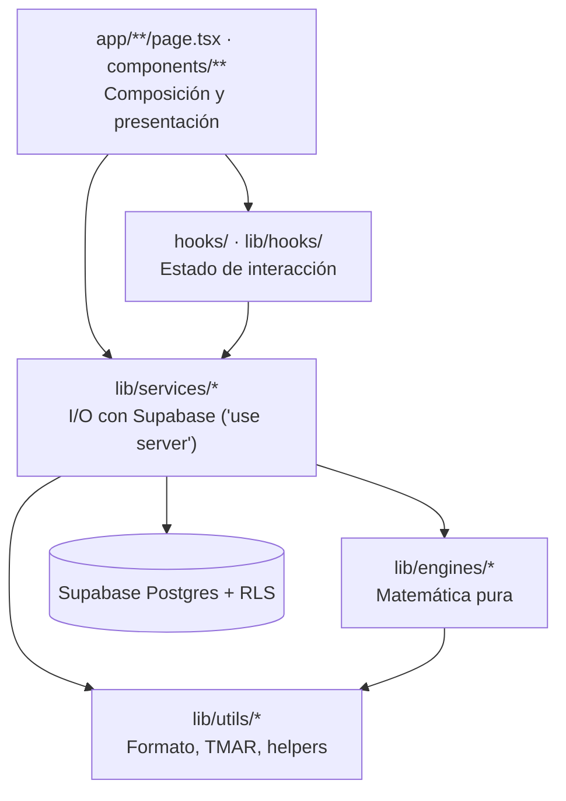
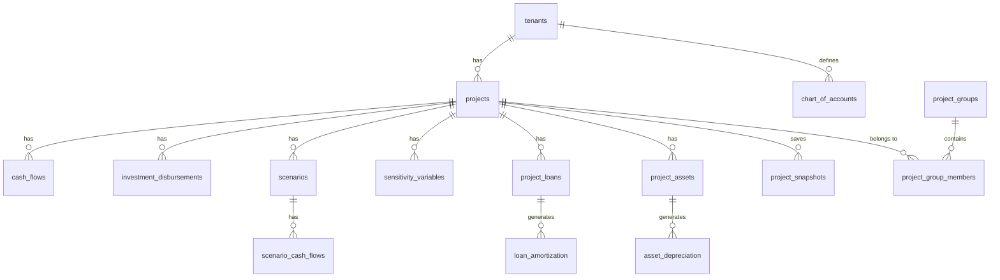

# Arquitectura — EconoLab

## 1. Capas

Reglas de dependencia: las flechas **no se invierten**. Un engine no importa services; un service no importa componentes.

## 2. Estructura de carpetas

| Ruta | Contenido |
|---|---|
| `app/` | Páginas y layouts (App Router). Sin `[locale]`: el idioma va en la cookie `locale` |
| `app/dashboard/*` | Análisis globales: `vpn`, `tir`, `tmar`, `benefit-cost`, `cash-flow`, `reports`, `settings`, `alternatives` |
| `app/dashboard/projects/[id]/*` | Módulos por proyecto: `edit`, `investment`, `control`, `scenarios`, `financing`, `assets`, `pro-forma` |
| `components/ui/` | Primitivas shadcn |
| `components/dashboard/`, `components/project-form/`, `components/landing/` | Componentes por dominio |
| `lib/engines/` | `financial`, `amortization`, `depreciation`, `scenario`, `sensitivity`, `wacc` |
| `lib/services/` | `projects`, `project-groups`, `alternatives-analysis`, `disbursements`, `actual-flows`, `scenarios`, `loans`, `assets`, `pro-forma`, `project-analytics`, `portfolio-analytics`, `user-profiles` |
| `lib/supabase/` | Clientes browser/server, `middleware.ts` (`updateSession`) |
| `lib/routes.ts` | Fuente única de URLs. Añade aquí cada ruta nueva |
| `i18n/`, `messages/` | next-intl: configuración y `es.json` / `en.json` |
| `supabase/migrations/` | Esquema versionado (inmutable) |
| `proxy.ts` | Protege `/dashboard/*` (redirige a `/auth`) y refresca sesión |
| `docs/` | Documentación (este directorio) |

## 3. Modelo de datos

Migraciones (orden cronológico):

| Archivo | Aporta |
|---|---|
| `20260613152538_remote_schema` | `projects`, `cash_flows`, `tenants`, `user_profiles` (+RLS) |
| `20260613185000_lifecycle_foundations` | `phase`, `lifecycle_status`, `project_groups`, `project_group_members`, `project_snapshots` |
| `20260613191410_seed_data` | Datos semilla |
| `20260614000000_investment_disbursements` | Cronograma de inversión |
| `20260614100000_actual_flows_and_scenarios` | `flow_type`, `scenarios`, `scenario_cash_flows`, `sensitivity_variables` |
| `20260614200000_financing_and_depreciation` | `project_loans`, `loan_amortization`, `project_assets`, `asset_depreciation`, `chart_of_accounts` |

> Estado al escribir esto: las 3 últimas migraciones y todo el código de las capas Sprint 2–4 estaban **sin commitear** y sin evidencia de aplicación en el remoto. Verifica con `supabase db push --dry-run` antes de asumirlas.

## 4. Seguridad

- **Auth:** Supabase Auth (email). `proxy.ts` + `updateSession` protegen `/dashboard/*`.
- **Autorización real = RLS.** Patrón en cascada: las tablas hijas autorizan con `EXISTS (SELECT 1 FROM projects p WHERE p.id = <tabla>.project_id AND p.user_id = auth.uid())`.
- Las tablas hijas profundas (`loan_amortization`, `asset_depreciation`, `scenario_cash_flows`) deben seguir la cascada de 2 niveles (hijo → padre → `projects`).
- `.env` no se versiona; `.env.example` documenta `NEXT_PUBLIC_SUPABASE_URL` y `NEXT_PUBLIC_SUPABASE_ANON_KEY`.
- Los archivos de `lib/services/*` con `"use server"` exponen **cada función exportada como endpoint invocable**. Por eso RLS es obligatorio y no se debe confiar en que "solo la UI llama".

## 5. Internacionalización

Cookie `locale` → `app/layout.tsx` carga mensajes → `NextIntlClientProvider`. Selector: `components/language-switcher.tsx`.

## 6. Patrones recomendados para código nuevo

| Necesidad | Patrón |
|---|---|
| Calcular algo | Función en `lib/engines/` + test |
| Persistir | Función en `lib/services/` que valida con `zod`, escribe y llama al engine |
| Mutación desde UI | Server Action fina que orquesta service + `revalidatePath` |
| Nueva ruta | Página en `app/` + entrada en `lib/routes.ts` + item en `components/dashboard/app-sidebar.tsx` + claves i18n |
| Tabla nueva | Migración + RLS en cascada + índices en FKs + tipo TS asociado |
