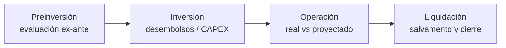

# Lógica de negocio — EconoLab

Documento canónico de **qué calcula el sistema y por qué**. Si cambias una fórmula, actualiza este archivo en el mismo commit.
Código de referencia entre paréntesis. Estado: derivado de la lectura del código (no de intenciones del plan).

## 1. Glosario

| Término | Significado |
|---|---|
| **VPN / NPV** | Valor Presente Neto: valor hoy de todos los flujos descontados a la tasa de descuento |
| **TIR / IRR** | Tasa que hace VPN = 0 |
| **TMAR** | Tasa Mínima Aceptable de Rendimiento: umbral que exige el inversionista |
| **Tasa de descuento** | Tasa usada para el VPN. Puede ser manual o la TMAR (`use_tmar_as_discount_rate`) |
| **B/C** | Relación Beneficio/Costo: VP(beneficios) / VP(costos) |
| **Payback / PRI** | Periodo de recuperación de la inversión (simple o descontado) |
| **IR** | Índice de rentabilidad = VPN / I₀ + 1 |
| **BAUE / CAUE** | Beneficio/Costo Anual Uniforme Equivalente (comparar proyectos de vida distinta) |
| **CAPEX** | Inversión en activos. Fuente: `investment_disbursements` |
| **Desembolso** | Pago de inversión en un periodo, con categoría y estado |
| **Flujo proyectado / real** | `cash_flows.flow_type = 'projected' \| 'actual'` |
| **Alternativas excluyentes** | Grupo de proyectos de los que solo se elige uno (`project_groups`) |
| **Escenario** | Variante del proyecto (optimista, pesimista, esperado, custom) con probabilidad |
| **WACC** | Costo promedio ponderado de capital |
| **Pro-forma** | Estados financieros proyectados (resultados, flujo de caja libre) |

## 2. Convenciones (ver también `AGENTS.md` §3)

| Tema | Regla |
|---|---|
| **Unidades de tasa** | BD/UI: porcentaje (`12`). Engines: decimal (`0.12`). Conversión en el borde. |
| **Periodos** | `t=0` inversión inicial · flujos operativos `t≥1` · desembolsos pueden ser `t<0` |
| **Signo** | `inflow` y `outflow` siempre ≥ 0 por separado; el neto es `inflow − outflow` |
| **Inversión inicial** | Número positivo (el engine aplica el signo) |
| **Redondeo** | Los engines devuelven números sin redondear, salvo pro-forma (enteros) y BAUE (2 decimales). Redondea en la UI. |
| **Moneda** | Formato en `lib/utils/currency-format.ts` |

## 3. Ciclo de vida del proyecto



`projects.phase` = `preinversion | inversion | operacion | liquidacion` y `projects.lifecycle_status` = `projected | evaluated | in_execution | operating | closed` (ambos con `CHECK` en BD).
Los datos previos al módulo avanzado migraron como `preinversion / projected` (o `evaluated` si estaban completados).

## 4. Indicadores de evaluación (`lib/engines/financial-engine.ts`)

Con `r` decimal, `I₀` inversión inicial, `Fₜ = inflowₜ − outflowₜ`:

| Indicador | Fórmula | Función |
|---|---|---|
| VPN | `−I₀ + Σ Fₜ/(1+r)^t` | `calculateNPV` |
| VPN con desembolsos | `−Σ Dₜ/(1+r)^t + Σ Fₜ/(1+r)^t` (`D` usa `actualAmount` si `useActual`) | `calculateNPVWithDisbursements` |
| TIR | Newton-Raphson sobre el VPN (semilla 0.10, 100 iter., tol. 1e-6). Devuelve `null` si el resultado no es finito o `< −0.99` | `calculateIRR`, `calculateIRRWithDisbursements` |
| B/C | `VP(inflows) / (I₀ + VP(outflows))`; 0 si el denominador es 0 | `calculateBenefitCostRatio` |
| Payback | Acumulado hasta ≥ 0, con interpolación lineal: `t−1 + |acum₍t−1₎|/Fₜ`. Descontado si `r > 0` | `calculatePaybackPeriod` |
| IR | `VPN/I₀ + 1` | `calculateProfitabilityIndex` |
| BAUE | `VPN · r(1+r)^n / ((1+r)^n − 1)` | `calculateEquivalentAnnualWorth` |

**Criterio de decisión (proyecto individual):** viable si `VPN ≥ 0` ⇔ `TIR ≥ tasa de descuento` ⇔ `B/C ≥ 1` ⇔ `IR ≥ 1`.

Ejemplo de verificación (usar como test de oro):
`I₀ = 1000`, `F₁=F₂=F₃ = 500`, `r = 10 %` → VPN = `−1000 + 500·(0.9091+0.8264+0.7513)` = **243.43**; TIR ≈ **23.38 %**; Payback simple = **2.0**.

## 5. TMAR (`lib/utils/tmar.ts`)

| Método (`tmar_method`) | Fórmula | Cuándo |
|---|---|---|
| `simple` — inversionista único | `TMAR = f + β + f·β` (f inflación, β prima de riesgo) | Un solo aportante |
| `mixta` — varios aportantes | `TMAR = Σ shareᵢ · costᵢ` (shares en %, deben sumar 100) | Capital propio + deuda |

`resolveProjectTmarPercent` elige el método. `getEffectiveDiscountRate` (`project-analytics.ts`) decide si el VPN usa la TMAR o la tasa manual.
Existe además `calculateTmarDecimal` (Fisher con ganancia real `i = libre de riesgo + prima`); **no** es la ruta que usa el proyecto hoy.

## 6. Alternativas mutuamente excluyentes (`lib/services/alternatives-analysis.ts`)

1. Todas se evalúan con **la misma tasa** del grupo (`project_groups.comparison_rate`, por defecto 12 %).
2. Se ordenan por inversión ascendente. El de menor inversión es el "campeón".
3. Cada retador se compara contra el campeón con **flujos incrementales** `ΔFₜ = Fₜ(retador) − Fₜ(campeón)` y `ΔI₀`.
4. Se justifica el cambio si `ΔVPN > 0` **o** `ΔTIR > tasa`. El retador justificado pasa a ser campeón.
5. Recomendación final: el campeón si su VPN ≥ 0; si no, **rechazar todas**.
6. Rankings auxiliares por VPN.

Limitaciones conocidas: ver `AI-READINESS-AUDIT.md` (vidas desiguales y alternativa "no hacer nada").

## 7. Inversión y desembolsos (`lib/services/disbursements.ts`)

- Fuente de verdad del CAPEX: `investment_disbursements` (periodo, categoría, `planned_amount`, `actual_amount`, estado, `account_code`).
- Categorías: terreno, construcción, equipo, capital de trabajo, otro.
- Estados: `pending → committed → disbursed` (o `cancelled`).
- `projects.initial_investment` es un **resumen derivado** (`syncProjectInitialInvestment`).
- KPIs: total planificado, total ejecutado, % avance, desvío presupuestal, agrupado por categoría.

## 8. Control operativo: real vs proyectado (`lib/services/actual-flows.ts`)

- `recordActualFlow` guarda flujos con `flow_type = 'actual'`.
- Informe de varianza por periodo: `{ proyectado, real, varianza, varianza % }`.
- Alertas cuando `|varianza %|` supera un umbral.
- KPI: VPN con flujos reales vs VPN original.

## 9. Escenarios y sensibilidad (`lib/engines/scenario-engine.ts`, `sensitivity-engine.ts`)

| Concepto | Regla |
|---|---|
| Flujos de escenario | Variación porcentual sobre flujos base (`generateScenarioFlows`) |
| VPN esperado | `E[VPN] = Σ pᵢ · VPNᵢ` (`buildExpectedValueNpv`) |
| Riesgo | Desviación estándar y coeficiente de variación `σ/μ` (`calculateRiskMetrics`) |
| Sensibilidad 1D | Una variable en un rango → gráfico tornado |
| Sensibilidad 2D | Dos variables → matriz (heatmap) |
| Punto de equilibrio | Valor de la variable donde VPN = 0 (`findBreakevenPoint`) |

Un escenario por tipo predefinido y proyecto (`UNIQUE(project_id, type)`). `probability` ∈ [0, 100].

## 10. Financiamiento (`amortization-engine.ts`, `wacc-engine.ts`, `loans.ts`)

| Tipo (`payment_type`) | Regla |
|---|---|
| `french` | Cuota constante |
| `german` | Abono a capital constante |
| `american` | Solo intereses; capital al final (bullet) |
| `custom` | Definido por el usuario |

`grace_periods`: periodos de gracia. `generateAmortizationTable` produce filas `(saldo inicial, cuota, capital, interés, saldo final)` que se persisten en `loan_amortization`.
**WACC** = `E/V·Ke + D/V·Kd·(1−t)`. Se compara con la TMAR en la UI.

## 11. Activos y depreciación (`depreciation-engine.ts`)

Métodos implementados: **línea recta**, **saldo decreciente**, **suma de dígitos de los años**.
La BD además admite `units_of_production`, **sin engine** (brecha).
Categorías: terreno, edificio, equipo, vehículo, mobiliario, intangible, otro. El terreno normalmente no se deprecia.

## 12. Estados pro-forma (`financial-engine.ts` + `lib/services/pro-forma.ts`)

Por periodo `t ≥ 1`:

```
EBITDA = Ingresos − Costos operativos
EBIT   = EBITDA − Depreciación
EBT    = EBIT − Intereses
Impuesto = EBT > 0 ? EBT · tasa : 0          (tasa por defecto 35 %)
Utilidad neta = EBT − Impuesto
FCL    = Utilidad neta + Depreciación − CAPEX − ΔCapital de trabajo
FCA    = FCL + Desembolsos de deuda − Amortización de capital
```

> ⚠️ **Pendiente de validación con un experto financiero:** el "FCL (FCFF)" parte de la utilidad neta, que ya descuenta intereses.
> La definición de manual de FCFF parte de `EBIT·(1−t)`. Hoy el "FCL" se comporta como flujo del accionista antes de movimientos de deuda. Decidir y documentar el criterio.

## 13. Contabilidad (futuro)

Cada tabla con movimiento financiero tiene `account_code` (opcional) como llave lógica hacia `chart_of_accounts.code` (PUC Colombia).
Existe la tabla `chart_of_accounts` por tenant; **no hay UI ni asientos** todavía.

## 14. Reglas de validación sugeridas (backlog)

| Entidad | Regla |
|---|---|
| Tasa | `r > −1` (ya validada en NPV) |
| `periods` | entero ≥ 1 |
| `funding_sources` | `Σ share = 100` |
| Escenarios | `Σ probability` de los usados en VPN esperado ≈ 100 |
| Grupo | Proyectos con horizontes compatibles |
