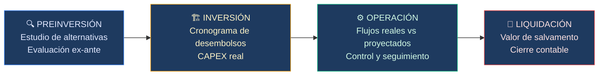
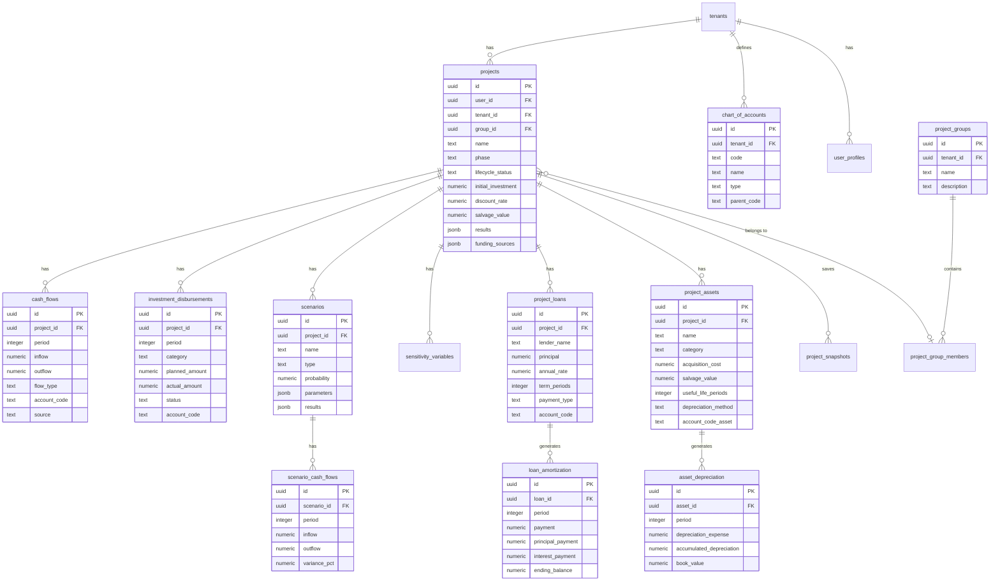

# Plan de Escalamiento: MVP → Módulo Avanzado de Ciclo de Vida de Proyectos de Inversión

> [!NOTE]
> **ESTADO GENERAL DE IMPLEMENTACIÓN: 100% COMPLETADO (TODOS LOS SPRINTS 1, 2, 3 Y 4 FINALIZADOS)**
> Todas las migraciones SQL, motores matemáticos puros, capas de servicios y páginas frontend han sido desarrolladas, integradas y chequeadas (`[x]`).

---

## 1. EVALUACIÓN DE LA ARQUITECTURA ACTUAL (Dónde Estamos vs. Dónde Vamos)

### 1.1 Estado Actual — Radiografía del MVP

Tras analizar el código fuente completo, el MVP opera con un modelo de datos **flat y estático**:

#### Esquema de Base de Datos Actual

| Tabla | Propósito | Limitaciones para el nuevo alcance |
|---|---|---|
| [projects](file:///c:/Users/justi/Documents/dev/economic-project-evaluation-platform/supabase/migrations/20260613152538_remote_schema.sql#L120-L141) | Proyecto monolítico con `initial_investment` como un solo número | No soporta desembolsos multi-periodo, ni fases de ciclo de vida, ni escenarios |
| [cash_flows](file:///c:/Users/justi/Documents/dev/economic-project-evaluation-platform/supabase/migrations/20260613152538_remote_schema.sql#L105-L114) | Flujos con `inflow`/`outflow` por periodo | Solo tiene `source = 'manual' | 'from_accounting'`, sin distinción entre flujo proyectado y real |
| [user_profiles](file:///c:/Users/justi/Documents/dev/economic-project-evaluation-platform/supabase/migrations/20260613152538_remote_schema.sql#L159-L186) | Perfil con defaults de tasas | Ya tiene campos de `accounting_method` y `business_type` — buena base |
| [tenants](file:///c:/Users/justi/Documents/dev/economic-project-evaluation-platform/supabase/migrations/20260613152538_remote_schema.sql#L147-L153) | Multi-tenant básico | Solo `settings` como JSONB genérico, sin catálogos contables |

#### Capa de Servicios Actual

| Archivo | Rol | Brecha identificada |
|---|---|---|
| [projects.ts](file:///c:/Users/justi/Documents/dev/economic-project-evaluation-platform/lib/services/projects.ts) | CRUD de proyectos + flujos | `createProjectWithFlows` usa `any` para payload/flows — sin tipado fuerte |
| [project-analytics.ts](file:///c:/Users/justi/Documents/dev/economic-project-evaluation-platform/lib/services/project-analytics.ts) | VPN, TIR, B/C, Payback | Todos los cálculos asumen un solo set de flujos, sin escenarios ni variaciones |
| [portfolio-analytics.ts](file:///c:/Users/justi/Documents/dev/economic-project-evaluation-platform/lib/services/portfolio-analytics.ts) | Métricas consolidadas de portafolio | No distingue entre proyectos "alternativos" y proyectos independientes |
| [tmar.ts](file:///c:/Users/justi/Documents/dev/economic-project-evaluation-platform/lib/utils/tmar.ts) | TMAR simple y mixta (WACC básico) | No modela créditos como entidades propias ni tabla de amortización |

#### Componentes Frontend

| Componente | Observación |
|---|---|
| [project-form.tsx](file:///c:/Users/justi/Documents/dev/economic-project-evaluation-platform/components/project-form.tsx) | Formulario monolítico de 661 líneas — necesita descomposición en sub-componentes |
| Dashboard `/alternatives/[groupId]` | **Directorio vacío** — la feature de alternativas no está implementada |

### 1.2 Brechas Críticas — Modelo de Ciclo de Vida

El ciclo de vida real de un proyecto de inversión tiene 4 fases que el MVP actual **no modela**:



> [!WARNING]
> **Refactorización obligatoria**: La columna `projects.initial_investment` debe dejar de ser la única fuente de verdad para el CAPEX. Un proyecto real distribuye inversiones en múltiples periodos (año -2, -1, 0, 1...). El campo actual debe conservarse como **resumen calculado** (suma de todos los desembolsos de inversión), pero la fuente de verdad serán los registros de `investment_disbursements`.

> [!IMPORTANT]
> **Estrategia de migración no-destructiva**: Todas las tablas nuevas se **añaden** al esquema. La tabla `projects` existente gana nuevas columnas (`phase`, `lifecycle_status`, `group_id`). Los datos existentes migrarán con `phase = 'preinversion'` y `lifecycle_status = 'projected'` por defecto. **Ningún dato existente se pierde ni se rompe.**

---

## 2. PLAN DE DESARROLLO E IMPLEMENTACIÓN — 4 Sprints

### Sprint 1: Fundaciones y Alternativas Mutuamente Excluyentes (3-4 semanas)

> **Objetivo**: Refactorizar el esquema base para soportar el ciclo de vida y permitir la comparación de alternativas.

#### 2.1.1 Tareas de Base de Datos

- [x] **Migración `001_lifecycle_foundations.sql`**:
  - [x] Añadir a `projects`: `phase TEXT DEFAULT 'preinversion'`, `lifecycle_status TEXT DEFAULT 'projected'`, `group_id UUID NULL`
  - [x] Crear tabla `project_groups` (grupos de alternativas mutuamente excluyentes)
  - [x] Crear tabla `project_group_members` (vincula proyectos a un grupo con ranking)
  - [x] Crear tabla `project_snapshots` (snapshots inmutables de evaluaciones para historial)
  - [x] Migrar datos existentes: `UPDATE projects SET phase = 'preinversion', lifecycle_status = CASE WHEN status = 'completed' THEN 'evaluated' ELSE 'projected' END`

- [x] **RLS Policies**: Todas las tablas nuevas deben heredar el patrón de RLS existente (verificación vía `projects.user_id = auth.uid()`)

#### 2.1.2 Tareas de Backend (Services)

- [x] Crear `lib/services/project-groups.ts`:
  - [x] `createGroup(name, description)` → inserta en `project_groups`
  - [x] `addProjectToGroup(groupId, projectId, rank?)` → valida que todos los proyectos del grupo compartan parámetros compatibles (mismo horizonte o ajuste automático)
  - [x] `removeProjectFromGroup(groupId, projectId)`
  - [x] `fetchGroupWithProjects(groupId)` → JOIN con `projects` y `cash_flows`

- [x] Crear `lib/services/alternatives-analysis.ts`:
  - [x] `compareAlternatives(projectIds[])` → calcula VPN, TIR, B/C, Payback para cada uno con la **misma tasa de descuento**
  - [x] `rankByNpv(alternatives)`, `rankByIrr(alternatives)`, `rankByBcRatio(alternatives)`
  - [x] `calculateIncrementalIrr(projectA, projectB)` → TIR incremental para decidir entre dos alternativas
  - [x] `generateComparisonMatrix(alternatives)` → tabla comparativa completa

- [x] Refactorizar [project-analytics.ts](file:///c:/Users/justi/Documents/dev\economic-project-evaluation-platform/lib/services/project-analytics.ts): Extraer funciones de cálculo puro (VPN, TIR) a `lib/engines/financial-engine.ts` para reutilización

#### 2.1.3 Tareas de Frontend

- [x] Implementar `/dashboard/alternatives/[groupId]/page.tsx`:
  - [x] Vista de comparación side-by-side con tabla matricial
  - [x] Gráfico radar (Recharts) comparando indicadores normalizados
  - [x] Indicador visual de "alternativa ganadora"

- [x] Descomponer [project-form.tsx](file:///c:/Users/justi/Documents/dev/economic-project-evaluation-platform/components/project-form.tsx) (661 líneas) en:
  - [x] `ProjectInfoSection.tsx` (nombre, descripción, inversión)
  - [x] `FinancialParametersSection.tsx` (tasas, TMAR)
  - [x] `CashFlowTableSection.tsx` (tabla de flujos)
  - [x] `ResultsPreviewPanel.tsx` (panel lateral de resultados)

---

### Sprint 2: Cronograma de Desembolsos e Inversión Detallada (3-4 semanas)

> **Objetivo**: Modelar la fase de inversión con cronograma temporal de desembolsos y seguimiento de CAPEX real.

#### 2.2.1 Tareas de Base de Datos

- [x] **Migración `002_investment_disbursements.sql`**:

```sql
-- Cronograma de desembolsos de inversión
CREATE TABLE investment_disbursements (
    id UUID DEFAULT gen_random_uuid() PRIMARY KEY,
    project_id UUID NOT NULL REFERENCES projects(id) ON DELETE CASCADE,
    period INTEGER NOT NULL,          -- Puede ser negativo (-2, -1, 0, 1...)
    category TEXT NOT NULL,           -- 'land', 'construction', 'equipment', 'working_capital', 'other'
    description TEXT DEFAULT '',
    planned_amount NUMERIC DEFAULT 0 NOT NULL,
    actual_amount NUMERIC DEFAULT 0,  -- NULL si aún no ejecutado
    execution_date DATE,
    status TEXT DEFAULT 'pending' CHECK (status IN ('pending', 'committed', 'disbursed', 'cancelled')),
    account_code TEXT DEFAULT '',     -- Futuro mapeo PUC: ej. '1520' = Maquinaria y equipo
    created_at TIMESTAMPTZ DEFAULT now() NOT NULL
);

CREATE INDEX idx_disbursements_project ON investment_disbursements(project_id);
CREATE INDEX idx_disbursements_period ON investment_disbursements(project_id, period);
```

- [x] **Migración de datos existentes**: Para cada proyecto con `initial_investment > 0`, insertar un registro en `investment_disbursements` con `period = 0, category = 'other', planned_amount = initial_investment`

#### 2.2.2 Tareas de Backend

- [x] Crear `lib/services/disbursements.ts`:
  - [x] CRUD completo de desembolsos
  - [x] `calculateTotalPlannedInvestment(projectId)` → suma de `planned_amount`
  - [x] `calculateTotalActualInvestment(projectId)` → suma de `actual_amount`
  - [x] `getExecutionProgress(projectId)` → % ejecutado vs planificado
  - [x] `getDisbursementsByCategory(projectId)` → agrupado por categoría

- [x] Actualizar `lib/engines/financial-engine.ts`:
  - [x] El VPN ahora debe considerar desembolsos en periodos negativos con descuento inverso: `PV = C_t / (1+r)^t` donde `t` puede ser negativo
  - [x] La TIR se calcula sobre el flujo completo incluyendo periodos pre-operativos

#### 2.2.3 Tareas de Frontend

- [x] Crear componente `DisbursementSchedule.tsx`:
  - [x] Diagrama de Gantt simplificado (timeline con barras horizontales usando `recharts`)
  - [x] Tabla de desembolsos con estado y progreso
  - [x] Barra de progreso de ejecución presupuestal

- [x] Crear página `/dashboard/projects/[id]/investment/page.tsx`:
  - [x] Vista dedicada al cronograma de inversión del proyecto
  - [x] Indicadores: Total planificado, Total ejecutado, % avance, Desvío presupuestal

---

### Sprint 3: Control Operativo y Análisis de Sensibilidad (4-5 semanas)

> **Objetivo**: Habilitar el seguimiento real vs. proyectado y el análisis multi-escenario.

#### 2.3.1 Tareas de Base de Datos — Flujos Reales y Escenarios

- [x] **Migración `003_actual_flows_and_scenarios.sql`**:

```sql
-- Extender cash_flows para soportar flujos reales
ALTER TABLE cash_flows ADD COLUMN flow_type TEXT DEFAULT 'projected' 
    CHECK (flow_type IN ('projected', 'actual'));
ALTER TABLE cash_flows ADD COLUMN account_code TEXT DEFAULT '';
ALTER TABLE cash_flows ADD COLUMN notes TEXT DEFAULT '';
ALTER TABLE cash_flows ADD COLUMN recorded_at TIMESTAMPTZ DEFAULT now();

-- Escenarios de análisis
CREATE TABLE scenarios (
    id UUID DEFAULT gen_random_uuid() PRIMARY KEY,
    project_id UUID NOT NULL REFERENCES projects(id) ON DELETE CASCADE,
    name TEXT NOT NULL,           -- 'optimista', 'pesimista', 'esperado', 'custom_1'
    type TEXT DEFAULT 'custom' CHECK (type IN ('base', 'optimistic', 'pessimistic', 'expected', 'custom')),
    description TEXT DEFAULT '',
    probability NUMERIC DEFAULT 0 CHECK (probability >= 0 AND probability <= 100),
    parameters JSONB DEFAULT '{}',  -- Override de parámetros: {"discount_rate": 15, "inflation": 5}
    results JSONB,                  -- VPN, TIR, B/C calculados para este escenario
    created_at TIMESTAMPTZ DEFAULT now() NOT NULL,
    updated_at TIMESTAMPTZ DEFAULT now() NOT NULL,
    UNIQUE(project_id, type) -- Solo un escenario de cada tipo predefinido
);

-- Flujos específicos de cada escenario
CREATE TABLE scenario_cash_flows (
    id UUID DEFAULT gen_random_uuid() PRIMARY KEY,
    scenario_id UUID NOT NULL REFERENCES scenarios(id) ON DELETE CASCADE,
    period INTEGER NOT NULL,
    inflow NUMERIC DEFAULT 0 NOT NULL,
    outflow NUMERIC DEFAULT 0 NOT NULL,
    variance_pct NUMERIC DEFAULT 0,  -- % variación respecto al flujo base
    UNIQUE(scenario_id, period)
);

-- Sensibilidad: qué variables se varían y en qué rango
CREATE TABLE sensitivity_variables (
    id UUID DEFAULT gen_random_uuid() PRIMARY KEY,
    project_id UUID NOT NULL REFERENCES projects(id) ON DELETE CASCADE,
    variable_name TEXT NOT NULL,    -- 'discount_rate', 'initial_investment', 'inflow_year_3', etc.
    base_value NUMERIC NOT NULL,
    min_value NUMERIC NOT NULL,
    max_value NUMERIC NOT NULL,
    step_size NUMERIC DEFAULT 1,
    created_at TIMESTAMPTZ DEFAULT now() NOT NULL
);
```

#### 2.3.2 Tareas de Backend — Motor de Escenarios

- [x] Crear `lib/engines/scenario-engine.ts`:
  - [x] `generateScenarioFlows(baseFlows, variationPercent)` → aplica variación porcentual
  - [x] `calculateScenarioResults(projectId, scenarioId)` → VPN, TIR, B/C con parámetros del escenario
  - [x] `buildExpectedValueNpv(scenarios[])` → VPN esperado = Σ(probabilidad × VPN_escenario)
  - [x] `calculateCoefficientOfVariation(scenarios[])` → σ / μ del VPN

- [x] Crear `lib/engines/sensitivity-engine.ts`:
  - [x] `runOneDimensionalSensitivity(project, variable, range)` → datos para gráfico Tornado
  - [x] `runTwoDimensionalSensitivity(project, varX, varY)` → matriz para heatmap
  - [x] `findBreakevenPoint(project, variable)` → valor de la variable donde VPN = 0

- [x] Crear `lib/services/actual-flows.ts`:
  - [x] `recordActualFlow(projectId, period, inflow, outflow, accountCode?)`
  - [x] `getVarianceReport(projectId)` → por periodo: `{ projected, actual, variance, variancePct }`
  - [x] `getDeviationAlerts(projectId, threshold)` → periodos donde varianza > threshold

#### 2.3.3 Tareas de Frontend — Dashboards de Control

- [x] Crear `/dashboard/projects/[id]/control/page.tsx`:
  - [x] Tabla comparativa: Flujo Proyectado | Flujo Real | Varianza | % Desviación
  - [x] Gráfico de líneas superpuestas (proyectado vs real) con Recharts
  - [x] Alertas visuales en periodos con desviación significativa
  - [x] KPIs: VPN con flujos reales vs VPN original

- [x] Crear `/dashboard/projects/[id]/scenarios/page.tsx`:
  - [x] Formulario de creación de escenarios (Optimista/Pesimista/Esperado)
  - [x] Tabla comparativa de escenarios con indicadores
  - [x] Gráfico Tornado para análisis de sensibilidad unidimensional
  - [x] Heatmap para sensibilidad bidimensional

---

### Sprint 4: Financiamiento Avanzado, Depreciación y Preparación Contable (4-5 semanas)

> **Objetivo**: Modelar créditos con tabla de amortización, depreciación de activos y sentar las bases del mapeo contable.

#### 2.4.1 Tareas de Base de Datos — Financiamiento y Depreciación

- [x] **Migración `004_financing_and_depreciation.sql`**:

```sql
-- Créditos / Préstamos vinculados a un proyecto
CREATE TABLE project_loans (
    id UUID DEFAULT gen_random_uuid() PRIMARY KEY,
    project_id UUID NOT NULL REFERENCES projects(id) ON DELETE CASCADE,
    lender_name TEXT NOT NULL,
    principal NUMERIC NOT NULL,
    annual_rate NUMERIC NOT NULL,        -- Tasa nominal anual (%)
    term_periods INTEGER NOT NULL,       -- Plazo en periodos
    payment_type TEXT DEFAULT 'french' 
        CHECK (payment_type IN ('french', 'german', 'american', 'custom')),
    grace_periods INTEGER DEFAULT 0,     -- Periodos de gracia
    start_period INTEGER DEFAULT 0,      -- Periodo en que inicia el crédito
    disbursement_schedule JSONB DEFAULT '[]',  -- [{period: 0, amount: 50000}, ...]
    account_code TEXT DEFAULT '',         -- Futuro PUC: '2105' = Obligaciones financieras
    created_at TIMESTAMPTZ DEFAULT now() NOT NULL
);

-- Tabla de amortización (calculada y almacenada)
CREATE TABLE loan_amortization (
    id UUID DEFAULT gen_random_uuid() PRIMARY KEY,
    loan_id UUID NOT NULL REFERENCES project_loans(id) ON DELETE CASCADE,
    period INTEGER NOT NULL,
    beginning_balance NUMERIC NOT NULL,
    payment NUMERIC NOT NULL,
    principal_payment NUMERIC NOT NULL,
    interest_payment NUMERIC NOT NULL,
    ending_balance NUMERIC NOT NULL,
    UNIQUE(loan_id, period)
);

-- Activos depreciables del proyecto
CREATE TABLE project_assets (
    id UUID DEFAULT gen_random_uuid() PRIMARY KEY,
    project_id UUID NOT NULL REFERENCES projects(id) ON DELETE CASCADE,
    name TEXT NOT NULL,
    category TEXT DEFAULT 'equipment' 
        CHECK (category IN ('land', 'building', 'equipment', 'vehicle', 'furniture', 'intangible', 'other')),
    acquisition_cost NUMERIC NOT NULL,
    salvage_value NUMERIC DEFAULT 0,
    useful_life_periods INTEGER NOT NULL,
    depreciation_method TEXT DEFAULT 'straight_line' 
        CHECK (depreciation_method IN ('straight_line', 'declining_balance', 'sum_of_years', 'units_of_production')),
    acquisition_period INTEGER DEFAULT 0,
    account_code_asset TEXT DEFAULT '',        -- PUC: '1520' Maquinaria
    account_code_depreciation TEXT DEFAULT '', -- PUC: '5260' Depreciación
    account_code_accumulated TEXT DEFAULT '',  -- PUC: '1592' Depreciación acumulada
    created_at TIMESTAMPTZ DEFAULT now() NOT NULL
);

-- Depreciación calculada por periodo
CREATE TABLE asset_depreciation (
    id UUID DEFAULT gen_random_uuid() PRIMARY KEY,
    asset_id UUID NOT NULL REFERENCES project_assets(id) ON DELETE CASCADE,
    period INTEGER NOT NULL,
    depreciation_expense NUMERIC NOT NULL,
    accumulated_depreciation NUMERIC NOT NULL,
    book_value NUMERIC NOT NULL,
    UNIQUE(asset_id, period)
);

-- Catálogo de cuentas contables (para futuro módulo contable)
CREATE TABLE chart_of_accounts (
    id UUID DEFAULT gen_random_uuid() PRIMARY KEY,
    tenant_id UUID NOT NULL REFERENCES tenants(id),
    code TEXT NOT NULL,              -- '1520', '2105', '4135', etc.
    name TEXT NOT NULL,              -- 'Maquinaria y equipo'
    type TEXT NOT NULL CHECK (type IN ('asset', 'liability', 'equity', 'revenue', 'expense')),
    parent_code TEXT,                -- Jerarquía: '15' → '1520'
    is_active BOOLEAN DEFAULT true,
    metadata JSONB DEFAULT '{}',
    UNIQUE(tenant_id, code)
);
```

#### 2.4.2 Tareas de Backend — Motores Financieros

- [x] Crear `lib/engines/amortization-engine.ts`:
  - [x] `calculateFrenchAmortization(principal, rate, periods, gracePeriods)` → cuota fija
  - [x] `calculateGermanAmortization(principal, rate, periods, gracePeriods)` → capital fijo
  - [x] `calculateAmericanAmortization(principal, rate, periods)` → bullet payment
  - [x] `generateAmortizationTable(loan)` → array de periodos para almacenar en `loan_amortization`

- [x] Crear `lib/engines/depreciation-engine.ts`:
  - [x] `calculateStraightLine(cost, salvage, life)` → depreciación constante
  - [x] `calculateDecliningBalance(cost, salvage, life, rate?)` → saldo decreciente
  - [x] `calculateSumOfYears(cost, salvage, life)` → suma de dígitos de los años
  - [x] `generateDepreciationSchedule(asset)` → tabla completa para `asset_depreciation`

- [x] Crear `lib/engines/wacc-engine.ts`:
  - [x] `calculateWacc(equityCost, debtCost, equityWeight, debtWeight, taxRate)` → WACC real
  - [x] `buildCapitalStructure(projectId)` → extrae pesos y costos de `project_loans` + equity
  - [x] `calculateLeveragedProjectNpv(projectId)` → VPN con flujos ajustados por financiamiento

- [x] Actualizar `lib/engines/financial-engine.ts`:
  - [x] **Estado de resultados proyectado**: Ingresos - Costos operativos - Depreciación - Intereses = Utilidad antes de impuestos
  - [x] **Flujo de caja libre**: Utilidad neta + Depreciación - CAPEX - ΔCapital de trabajo
  - [x] Nuevo cálculo: **CAUE/BAUE** (Costo/Beneficio Anual Uniforme Equivalente) para proyectos con vida útil diferente

#### 2.4.3 Tareas de Frontend

- [x] Crear `/dashboard/projects/[id]/financing/page.tsx`:
  - [x] CRUD de créditos con wizard de configuración
  - [x] Visualización de tabla de amortización
  - [x] Gráfico de composición del pago (capital vs intereses) por periodo
  - [x] Resumen WACC vs TMAR

- [x] Crear `/dashboard/projects/[id]/assets/page.tsx`:
  - [x] Lista de activos depreciables
  - [x] Tabla de depreciación por activo
  - [x] Gráfico de valor en libros vs tiempo

- [x] Crear `/dashboard/projects/[id]/pro-forma/page.tsx`:
  - [x] Estado de resultados proyectado completo
  - [x] Flujo de caja libre del proyecto
  - [x] Toggle entre vista "sin financiamiento" y "con financiamiento"

---

## 3. DISEÑO DE BASE DE DATOS — Diagrama Completo

### 3.1 Diagrama Entidad-Relación



### 3.2 Estrategia de Mapeo Contable (Puente al PUC)

> [!TIP]
> **Principio de diseño**: Cada tabla que genera un movimiento financiero tiene un campo `account_code TEXT DEFAULT ''`. Este campo es **opcional ahora**, pero cuando se implemente el módulo contable, servirá como foreign key lógica hacia `chart_of_accounts.code`.

| Concepto Financiero | Campo `account_code` | Ejemplo PUC Colombia |
|---|---|---|
| Desembolso de inversión (terreno) | `investment_disbursements.account_code` | `1504` — Terrenos |
| Desembolso (maquinaria) | `investment_disbursements.account_code` | `1520` — Maquinaria y equipo |
| Ingreso operacional | `cash_flows.account_code` (inflow) | `4135` — Comercio al por mayor |
| Gasto operacional | `cash_flows.account_code` (outflow) | `5195` — Diversos |
| Obligación bancaria | `project_loans.account_code` | `2105` — Bancos nacionales |
| Gasto depreciación | `project_assets.account_code_depreciation` | `5260` — Depreciación |
| Depreciación acumulada | `project_assets.account_code_accumulated` | `1592` — Depreciación acumulada |

Esto permite que **en el futuro**, una consulta simple pueda generar asientos contables:

```sql
-- Futuro: Generar libro diario desde datos del proyecto
SELECT 
    d.execution_date AS fecha,
    coa.code AS cuenta,
    coa.name AS nombre_cuenta,
    d.actual_amount AS debito,
    0 AS credito
FROM investment_disbursements d
JOIN chart_of_accounts coa ON coa.code = d.account_code
WHERE d.project_id = $1 AND d.status = 'disbursed'
```

---

## 4. CONSIDERACIONES TÉCNICAS EN EL STACK

### 4.1 Next.js 16 — Arquitectura

#### Server Actions para mutaciones financieras

```typescript
// lib/actions/scenarios.ts — Ejemplo de patrón recomendado
"use server";

import { createClient } from "@/lib/supabase/server";
import { revalidatePath } from "next/cache";
import { z } from "zod";

const CreateScenarioSchema = z.object({
  projectId: z.string().uuid(),
  name: z.string().min(1).max(100),
  type: z.enum(["base", "optimistic", "pessimistic", "expected", "custom"]),
  probability: z.number().min(0).max(100),
  parameters: z.record(z.number()).optional(),
});

export async function createScenario(input: z.infer<typeof CreateScenarioSchema>) {
  const validated = CreateScenarioSchema.parse(input);
  const supabase = await createClient();
  
  const { data, error } = await supabase
    .from("scenarios")
    .insert(validated)
    .select("id")
    .single();

  if (error) throw error;
  
  revalidatePath(`/dashboard/projects/${validated.projectId}/scenarios`);
  return data;
}
```

> [!IMPORTANT]
> **Patrón de cálculos pesados**: Los motores financieros (VPN con 30 periodos, TIR con Newton-Raphson, tablas de amortización de 360 cuotas) deben ejecutarse como **Server Actions** o en una **Supabase Edge Function**, **nunca en el cliente**. Esto protege la lógica de negocio y evita bloquear el UI thread.

#### Estructura de rutas propuesta

```
app/dashboard/
├── page.tsx                          (Dashboard existente)
├── projects/
│   ├── page.tsx                      (Lista existente)
│   ├── new/page.tsx                  (Crear proyecto existente)
│   └── [id]/
│       ├── edit/page.tsx             (Editar existente)
│       ├── investment/page.tsx       [NUEVO] Cronograma de desembolsos
│       ├── control/page.tsx          [NUEVO] Real vs Proyectado
│       ├── scenarios/page.tsx        [NUEVO] Escenarios y Sensibilidad
│       ├── financing/page.tsx        [NUEVO] Créditos y WACC
│       ├── assets/page.tsx           [NUEVO] Activos y Depreciación
│       └── pro-forma/page.tsx        [NUEVO] Estado de Resultados
├── alternatives/
│   ├── page.tsx                      [NUEVO] Lista de grupos
│   └── [groupId]/page.tsx            [NUEVO] Comparación de alternativas
├── vpn/page.tsx                      (Existente)
├── tir/page.tsx                      (Existente)
├── tmar/page.tsx                     (Existente)
├── benefit-cost/page.tsx             (Existente)
├── cash-flow/page.tsx                (Existente)
├── reports/page.tsx                  (Existente)
└── settings/page.tsx                 (Existente)
```

### 4.2 Supabase — Consideraciones Específicas

#### Row Level Security (RLS) — Patrón de cascada

Todas las tablas nuevas deben seguir el mismo patrón de RLS que ya usas en [cash_flows](file:///c:/Users/justi/Documents/dev/economic-project-evaluation-platform/supabase/migrations/20260613152538_remote_schema.sql#L270-L308), donde la autorización se verifica contra `projects.user_id`:

```sql
-- Ejemplo para scenarios
CREATE POLICY "Users can manage own scenarios" ON scenarios
    FOR ALL USING (
        EXISTS (
            SELECT 1 FROM projects p 
            WHERE p.id = scenarios.project_id 
            AND p.user_id = auth.uid()
        )
    );
```

#### Supabase Realtime para control operativo

Para el módulo de "Real vs Proyectado", usar Realtime para notificar cuando un flujo real se desvía significativamente:

```typescript
// Hook: useProjectAlerts(projectId)
const channel = supabase
  .channel(`project-${projectId}-alerts`)
  .on('postgres_changes', {
    event: 'INSERT',
    schema: 'public',
    table: 'cash_flows',
    filter: `project_id=eq.${projectId}`,
  }, (payload) => {
    if (payload.new.flow_type === 'actual') {
      checkDeviationAndNotify(payload.new);
    }
  })
  .subscribe();
```

#### Edge Functions para cálculos batch

Para operaciones como "recalcular todos los escenarios de un proyecto" o "generar tabla de amortización de 360 cuotas", usar Supabase Edge Functions:

```typescript
// supabase/functions/recalculate-scenarios/index.ts
Deno.serve(async (req) => {
  const { projectId } = await req.json();
  // ... lógica de cálculo batch
  // Actualizar resultados en cada scenario.results
});
```

### 4.3 Organización del código — Engines vs Services

```
lib/
├── engines/                    [NUEVO] Lógica de cálculo pura (sin I/O)
│   ├── financial-engine.ts     Refactorizado desde project-analytics.ts
│   ├── scenario-engine.ts      Motor de escenarios
│   ├── sensitivity-engine.ts   Análisis de sensibilidad
│   ├── amortization-engine.ts  Tablas de amortización
│   ├── depreciation-engine.ts  Métodos de depreciación
│   └── wacc-engine.ts          Costo promedio ponderado de capital
├── services/                   Capa de I/O (Supabase queries)
│   ├── projects.ts             Existente (refactorizar tipos)
│   ├── project-groups.ts       [NUEVO] Grupos de alternativas
│   ├── disbursements.ts        [NUEVO] Desembolsos de inversión
│   ├── actual-flows.ts         [NUEVO] Flujos reales
│   ├── scenarios.ts            [NUEVO] CRUD de escenarios
│   ├── loans.ts                [NUEVO] CRUD de créditos
│   ├── assets.ts               [NUEVO] CRUD de activos
│   └── chart-of-accounts.ts    [NUEVO] Catálogo contable
├── actions/                    [NUEVO] Server Actions (mutaciones)
│   ├── project-actions.ts
│   ├── scenario-actions.ts
│   ├── loan-actions.ts
│   └── asset-actions.ts
└── utils/
    ├── tmar.ts                 Existente
    ├── project-results.ts      Existente
    └── currency-format.ts      Existente
```

> [!TIP]
> **Principio clave**: Los `engines/` son funciones puras (input → output, sin dependencias de Supabase ni I/O). Los `services/` manejan la persistencia. Los `actions/` son Server Actions que orquestan services + engines + revalidación. Esto permite testear los engines con unit tests simples sin mocks de base de datos.

---

## Verification Plan

### Automated Tests

- **Unit tests** para cada engine (`financial-engine`, `amortization-engine`, `depreciation-engine`, `scenario-engine`):
  ```bash
  npx vitest run lib/engines/
  ```
- **Validación de migraciones** contra la instancia de Supabase:
  ```bash
  npx supabase db push --dry-run
  ```

### Manual Verification

- Crear un proyecto completo pasando por las 4 fases del ciclo de vida
- Verificar que los datos existentes del MVP siguen funcionando sin cambios (backward compatibility)
- Validar cálculos de amortización contra calculadoras financieras conocidas (ej. tabla de amortización francesa de un crédito de $100,000 al 12% a 5 años)
- Verificar RLS: un usuario no puede ver proyectos/escenarios/créditos de otro usuario

---

## Open Questions

> [!IMPORTANT]
> **¿Qué prioridad tiene el módulo contable?**
> El diseño actual prepara los `account_code` como campos opcionales. ¿Quieres que en el Sprint 4 ya se implemente la UI del Catálogo de Cuentas (PUC), o solo la tabla en DB como foundation para el futuro?

> [!IMPORTANT]
> **¿Necesitas soporte para proyectos con periodos mensuales?**
> Actualmente todo es anual (Year 0, Year 1...). Los créditos con amortización mensual requerirían un concepto de `period_unit` ('annual' | 'monthly' | 'quarterly'). Esto impacta cómo se alinean los flujos de la tabla de amortización con los periodos del proyecto.

> [!IMPORTANT]
> **¿Quieres Supabase Edge Functions o mantener todo en Server Actions de Next.js?**
> Para cálculos batch pesados (ej. recalcular 100 escenarios), una Edge Function es más eficiente porque ejecuta directamente contra la DB. Pero añade complejidad al deploy. Server Actions funcionan bien para operaciones individuales.

> [!WARNING]
> **Impacto en el formulario actual**: La descomposición de [project-form.tsx](file:///c:/Users/justi/Documents/dev/economic-project-evaluation-platform/components/project-form.tsx) (661 líneas) en sub-componentes es necesaria pero implica un refactor significativo del estado. ¿Lo hacemos en Sprint 1 como task paralela, o lo dejamos para cuando se implemente la nueva UX de tabs por fase?
